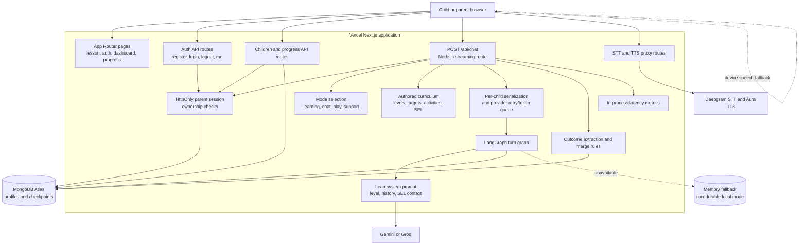

# Architecture Diagram

## Request Boundaries

- Pages are client-facing React routes under `src/app`.
- API routes authenticate the parent before reading or changing child data.
- `POST /api/chat` is a Node.js route because it uses LangGraph, provider SDKs, MongoDB, and streaming.
- External LLM and Deepgram credentials are server-only environment variables.
- The browser never calls the LLM or Deepgram directly.

## Main Chat Flow

1. The browser sends a child ID and one message to `POST /api/chat`.
2. The route verifies the parent owns that child and waits for any previous turn for the child.
3. Application code detects mode and selects authored curriculum, SEL, assessment, and teaching context.
4. LangGraph builds a lean system prompt and streams the tutor response from Gemini or Groq.
5. The response is streamed to the browser while the completed turn is extracted and merged into the profile.
6. The profile and learning records are persisted before the next turn selects a target.

## Persistence

MongoDB stores parent-owned profiles and LangGraph checkpoints. The process-memory fallback exists for local operation without MongoDB; it is not durable and should not be used for production.
